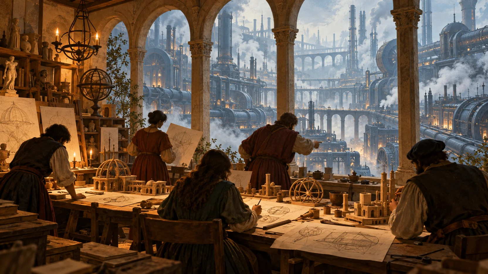
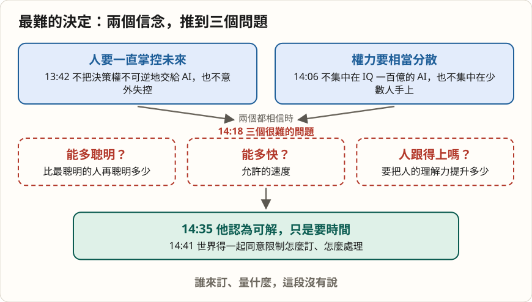
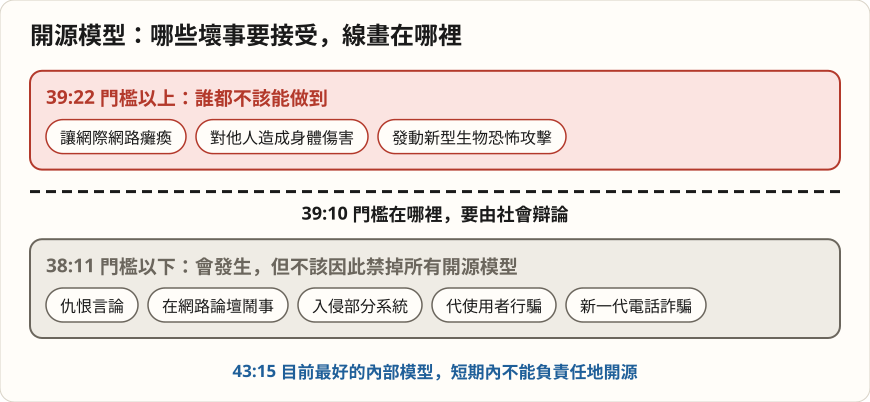
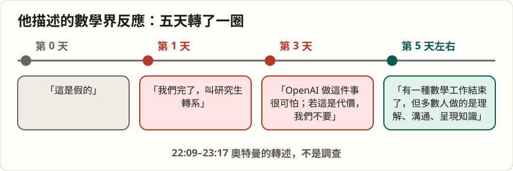

# 看見指數就往前衝的人，開始談速限：奧特曼在史丹佛商學院

*圖說：AI 生成的概念插畫，比喻奧特曼在訪談後段說的兩種未來：人在中心的文藝復興，對上把人當齒輪的工業革命。*

> 這是一篇導讀：先給重點與查證，再依話題看他說了什麼、哪些要打折。本導讀的分析與撰稿由 AI 模型完成，不是人類分析，也沒有經過人工逐句校稿，見文末〈製作說明〉。

訪談進行到第七分鐘，OpenAI 執行長山姆・奧特曼（Sam Altman）講起自己職涯裡最核心的一個體會：「規模會帶來出人意料的效果；當你看到某種漂亮地擴展的指數曲線，你就該繼續往前走」（[08:55](https://www.youtube.com/watch?v=anAmTGcewX8&t=535s)）。他說人的直覺不擅長處理這件事，而他對這個規律下了很重的注。

不到五分鐘後，訪問者問他現在最難做的決定是什麼。他給的頭號答案是：「大家有不同的叫法：暫停、控速、智慧速限」（[13:33](https://www.youtube.com/watch?v=anAmTGcewX8&t=813s)）。

這場是史丹佛商學院（Stanford GSB）的〈View From The Top〉講座，2026 年 10 月 21 日上傳，訪問者是 MBA 學生 Claudia Chen，後段開放學生提問。一個靠「看見指數就繼續走」走到今天的人，為什麼開始談速限？他說的速限由誰來訂？這場 48 分鐘的對談，又留給準備進入職場的學生什麼建議？

## 三十秒版

- 奧特曼說最難的決定是速限：他相信人要一直掌控未來、權力要相當分散，兩者加起來，就得回答「能讓 AI 比最聰明的人聰明多少、多快」。**他認為可解，但要時間，也要世界一起同意怎麼訂**；誰來訂、量什麼，這場沒有說。
- 他說過去半年的進展考驗了他的信念：在數學推理這類窄領域，「就我而言，我們現在已經有超級智慧了」。照這個速度再走一兩年，什麼都不改是行不通的。
- 學生問他 2020 年哪個信念錯了，他說是對齊：**對齊到目前比預期容易，可是對齊出錯的代價大幅升高**，他擔心有些團隊因此太敢往前衝。
- 資安是他點名最該重視、卻最少人關注的風險：漏洞補不完，防禦得整個換成用同一種技術打造的新防禦盾。
- 對工作，他不看「失業末日」，看短期內大量任務轉換；給 MBA 學生的建議是去做新的東西，別追五年前很酷的事。**他希望 AI 走向新的文藝復興，而不是把人當齒輪的工業革命**，但他也說，社會與經濟的壓力偏向無情的效率，得有一股力量來抗衡。
- 訪談裡的機構與事件（數學成果、Mythos、聯合國發言、晶片、Decoded 節目、OpenAI 基金會），逐項狀態見下表；有幾處是提問者帶進來的前提，不是他的說法。

## 先看重點：訪談中的說法，查得到什麼

| 訪談中的說法 | 查證結果 | 狀態 |
|---|---|---|
| 「現在每週有超過十億人使用 ChatGPT」（10:08，訪問者的提問前提） | OpenAI 8 月 31 日的公告寫 ChatGPT「每週活躍使用者超過 10 億」 | 已確認 |
| 在數學推理上「我們現在已經有超級智慧」（16:19） | 他的判斷。背景是 OpenAI 9 月宣稱的 Navier–Stokes 成果與 10 月公布的 722 份數學手稿，前者 Clay 數學研究所仍在評估 | 個人判斷 |
| 數學界「過去 10 天」的反應，第 0、1、3、5 天各不同（22:09） | 10 月 6 日公布手稿、隔天數學家團體發聲明批評，時間吻合；逐日的情緒變化是他的轉述 | 轉述 |
| 年初的「Mythos 恐慌」（19:45） | Anthropic 4 月 7 日公布 Project Glasswing，稱 Claude Mythos Preview 找出數千個高嚴重性漏洞；「恐慌」是他的形容 | 事件已確認 |
| 你最近在聯合國談 AI 安全、強調政府角色（18:11，訪問者的提問前提） | 9 月 23 日在聯合國安理會發言，OpenAI 公布的講稿說最重要的決定不能只由舊金山的實驗室來做，主張國內與國際的前沿 AI 標準 | 已確認 |
| 自研晶片 Jalapeño，下一代在後面（33:53） | 6 月 24 日與 Broadcom 發表；8 月官方測試稱特定負載下每瓦工作量為比較系統的 1.5–1.9 倍；下一代只有「多世代平台」的說法 | 部分確認 |
| 在 Decoded podcast 說世界應接受一些壞事（37:38，學生的提問前提） | POLITICO 的 Decoded 節目 10 月 5 日上架，媒體轉錄的原話是「世界應該接受一些壞事發生，以換取這項技術的好處」 | 已確認 |
| 「我們現在有全世界最大的基金會」（44:19） | 基金會持有 OpenAI 約 26% 股權，官方 2 月稱持股價值超過 1,800 億美元；有 250 億美元承諾與生物韌性計畫；「全球最大」查無可比對的排名 | 部分確認 |
| 解出 Navier–Stokes 的一萬個 agent，沒有領導者（47:22） | OpenAI 9 月公告寫約一萬個同時運作的 agent；成果本身 Clay 仍在評估 | 數量已確認，成果有爭議 |
| 30 歲生日寫的〈日子很長，十年很短〉（34:33，學生的提問前提） | 2015 年 4 月 28 日發表在他的部落格，開頭寫「上週滿 30 歲」 | 已確認 |

## 一、最難的決定：AI 該多快變聰明

訪問者問他現在最難做的決定。他先說這個問題可以講完剩下的時間，然後說頭號是速限。理由由兩個信念組成：「人應該一直掌控未來，我們不該刻意把決策權不可逆地交給 AI，也不該意外失控」（[13:42](https://www.youtube.com/watch?v=anAmTGcewX8&t=822s)）；再加上權力在未來要相當分散，他不想看到權力過度集中，「不管是集中在一個 IQ 一百億的 AI，還是集中在少數握有 AI、想做什麼就做什麼的人手上」（[14:06](https://www.youtube.com/watch?v=anAmTGcewX8&t=846s)）。

兩個都相信，就會走到很難的問題：「我們能讓 AI 系統比最聰明的人再聰明多少？多快？」（[14:18](https://www.youtube.com/watch?v=anAmTGcewX8&t=858s)），以及要把人理解這些系統的能力提升多少。他說：「我認為這是可以解決的，只是需要時間」（[14:35](https://www.youtube.com/watch?v=anAmTGcewX8&t=875s)）。

*圖說：本文歸納，非講者原圖；時間是訪談中的位置。*

接下來他把自己放在兩種極端中間：有人說任何監管都不好，他認為錯；有人說現在就得完全停止所有進展，「我認為這絕對是錯的」（[15:00](https://www.youtube.com/watch?v=anAmTGcewX8&t=900s)）。在社會風險最高的辯論裡，想當務實的中間派，是很難站的位置。

**這段的關鍵是「世界要一起同意限制怎麼訂」**，可是由誰訂、量的是能力還是部署、怎麼查核，他都沒有說。他公開談控速不是第一次：7 月與美國參議員會面後，他說過「隨著模型越來越強，需要控制它的速度」（[Bloomberg Government，2026-07-29](https://news.bgov.com/artificial-intelligence/openai-ceo-sam-altman-discusses-next-ai-model-with-us-lawmakers)）；OpenAI 9 月的 [Navier–Stokes 公告](https://openai.com/index/navier-stokes-solution/)也寫要對進展的步調做「更審慎的選擇」。「智慧速限」在本場是他列出的三個名稱之一；固定的上限、暫停時程或有約束力的制度，目前查不到公開資料。

> 重點：速限的理由講得很清楚，機制幾乎沒有講。讀這段時，把它當成問題的定義，不是答案。

## 二、半年的進展，考驗了他的信念

訪問者接著問，這半年能力加速，他身為務實中間派的想法有沒有變。他先列出沒變的：仍然相信迭代式部署，仍然相信社會必須在技術開發的同時面對它；仍然相信人非常有韌性、適應力強，「老實說不太在乎機器做的事」（[15:53](https://www.youtube.com/watch?v=anAmTGcewX8&t=953s)）。

然後是轉折：「話雖如此，看著過去六個月的進展速度，我對其中一些事情的信念受到了考驗」（[16:09](https://www.youtube.com/watch?v=anAmTGcewX8&t=969s)）。他說：「在某些狹義的層面上，比如數學推理，就我而言，我們現在已經有超級智慧了，我沒想到會這麼快」（[16:19](https://www.youtube.com/watch?v=anAmTGcewX8&t=979s)）。若再照類似速度走一兩年，而公司、政府與社會層面的協調都不變，「什麼都不改是行不通的」（[16:49](https://www.youtube.com/watch?v=anAmTGcewX8&t=1009s)），要守住前面那兩個信念，就得改變對控速的想法（[17:03](https://www.youtube.com/watch?v=anAmTGcewX8&t=1023s)）。

「數學推理已有超級智慧」是他的判斷，背景是 OpenAI 9 月 8 日宣稱的 [Navier–Stokes 成果](https://openai.com/index/navier-stokes-solution/)與 10 月 6 日公布的 [722 份數學手稿](https://openai.com/index/sharing-ai-progress-in-mathematics/)。前者 [Clay 數學研究所](https://www.claymath.org/news/navier-stokes-announcement/)表示評估仍在進行，後者未經獨立驗證，隔天就撤回 3 份、修訂 14 份（細節見另一篇 Cheeky Pint 訪談導讀的查證表）。

公司內部呢？他說，越多人親眼看到模型變得多好，內部辯論的分歧就越小（[17:18](https://www.youtube.com/watch?v=anAmTGcewX8&t=1038s)）。他的觀察是：以前的爭論大多是「模型會變多好、多快」，被包裝成「策略對不對」的爭論；前一題有答案之後，「該怎麼辦」的分歧就變小了，「仍有一些」（[18:00](https://www.youtube.com/watch?v=anAmTGcewX8&t=1080s)）。這是他對公司內部的描述，外界無從核對。

對政府，他說自己「其實滿滿意現在的趨勢」（[18:36](https://www.youtube.com/watch?v=anAmTGcewX8&t=1116s)）：之前覺得多數政府不夠認真，最近幾個月變了，「現在我覺得大概會」有好的進展（[18:56](https://www.youtube.com/watch?v=anAmTGcewX8&t=1136s)）。訪問者提到的聯合國發言，是 9 月 23 日在安理會。[OpenAI 公布的講稿](https://openai.com/index/sam-altman-un-security-council-remarks/)說，最重要的決定不能只由舊金山的實驗室來做，應經由民主程序、由對人民負責的政府參與，並主張建立國內與國際的前沿 AI 標準、事故通報與查核；[The National](https://www.thenationalnews.com/future/technology/2026/09/23/un-ai-sam-altman-dario-amodei/) 的報導另提到他提醒不要監管過頭。

## 三、對齊比預期容易，這正是他擔心的地方

學生提問時段，一位學生問：2020 年他抱持、後來證明錯了的強烈信念是什麼。奧特曼說：「我原本以為對齊問題會更難」（[35:50](https://www.youtube.com/watch?v=anAmTGcewX8&t=2150s)）。模型在一些重要面向已經遠超人類，而對齊到目前比預期容易，「我以前會很有把握地說，這兩件事裡有一件是錯的」（[36:12](https://www.youtube.com/watch?v=anAmTGcewX8&t=2172s)）。

他接著把話鋒轉向擔憂：有些人看到目前的進度，就以為下一代也會一樣，對齊會一直很容易，「我其實完全不覺得這是顯而易見的」（[36:29](https://www.youtube.com/watch?v=anAmTGcewX8&t=2189s)）。**而且對齊出錯的潛在代價大幅升高**（[36:33](https://www.youtube.com/watch?v=anAmTGcewX8&t=2193s)）。他在這裡重提沙箱、可監控性、對齊的排序，並把它連回前面的速限：「最終，這也是我先前談那個速限的原因，除了對齊，我認為沒有別的真的有用」（[36:59](https://www.youtube.com/watch?v=anAmTGcewX8&t=2219s)），而且要是人類夠聰明、看得懂，能有信心地說這個模型可以跑、人仍然掌控未來的那種對齊。

沙箱→監控→對齊這條排序，他在另一場 Cheeky Pint 訪談講得更細，本站的另一篇導讀已逐段整理，這裡不重複。這場多出來的是收尾那句：「我擔心世界上有些 AI 計畫，因為到目前為止對齊很容易，就對對齊太有信心，太願意往前衝」（[37:23](https://www.youtube.com/watch?v=anAmTGcewX8&t=2243s)）。他沒有點名是誰。

> 重點：在他的說法裡，對齊越順利，越要提防「下一代也會順利」的推論；這是他主張控速的第二個理由。

## 四、資安：補不完的漏洞

訪問者問個人與組織能為 AI 風險做什麼準備。他說為了不列出 30 件事，只講一件：資安。他說找不到夠戲劇化的字來形容迎面而來的問題，組織領導者、國家、個人都還沒有認真看待（[19:31](https://www.youtube.com/watch?v=anAmTGcewX8&t=1171s)）。

他提到年初「像是 Mythos 恐慌之類的時刻」（[19:45](https://www.youtube.com/watch?v=anAmTGcewX8&t=1185s)）。對應的是 Anthropic 4 月 7 日公布的 [Project Glasswing](https://www.anthropic.com/glasswing)：該公司稱 Claude Mythos Preview 找出數千個高嚴重性漏洞，涵蓋各主要作業系統與瀏覽器。他說那之後大家確實補了一些漏洞，但又一次沒有憑直覺理解指數成長：以為模型找到的就是全部漏洞，沒想到模型會更聰明，找到超出一般駭客威脅模型的、「硬體層級的瘋狂東西」（[20:22](https://www.youtube.com/watch?v=anAmTGcewX8&t=1222s)）。資安專業人員和資安長還在緊張，多數組織領導者已經往前走了，模型卻沒有停。

他的結論：「我已經不認為我們能把所有漏洞都補完」（[20:52](https://www.youtube.com/watch?v=anAmTGcewX8&t=1252s)），得把防禦模式整個換掉，用同樣的技術打造一種新的防禦盾（[20:55](https://www.youtube.com/watch?v=anAmTGcewX8&t=1255s)）。「我有點驚訝它得到的關注相對這麼少」（[21:05](https://www.youtube.com/watch?v=anAmTGcewX8&t=1265s)）。

**這是全場他語氣最急的一段**，但「新的防禦盾」長什麼樣子，本場沒有展開。後面談開放權重時，他又回到這個詞：OpenAI 基金會可以「衝刺幫世界建立防禦盾」（[44:19](https://www.youtube.com/watch?v=anAmTGcewX8&t=2659s)）。

## 五、開源的線，要畫在哪裡

一位學生引述他最近在 Decoded podcast 的說法，世界應該接受 AI 帶來的一些壞事，問他具體能接受什麼、線畫在哪裡。這個節目是 POLITICO 的 Decoded，10 月 5 日上架；媒體轉錄他的原話是「世界應該接受一些壞事發生，以換取這項技術的好處和人們的自主」，同一段也說不接受災難性的失控，這句話仍引起批評（[Tom's Guide，2026-10-08](https://www.tomsguide.com/ai/chatgpt/openai-ceo-sam-altman-on-ais-future-the-world-should-accept-some-bad-things-happening)）。

他第一句就說：「我真希望當時換個方式回答」（[37:56](https://www.youtube.com/watch?v=anAmTGcewX8&t=2276s)）。他要表達的是：人會有開源模型，有人會拿來產出仇恨言論、在網路論壇鬧事、入侵一些系統、代替使用者行騙（[38:11](https://www.youtube.com/watch?v=anAmTGcewX8&t=2291s)），新一代電話詐騙會比上一代糟得多。有人會因此主張禁掉所有開源模型；他說節目裡被剪掉的那部分是：禁掉所有開源模型，對創新與社會自由的代價極高，不該這麼做（[38:40](https://www.youtube.com/watch?v=anAmTGcewX8&t=2320s)）。

但有一條門檻，「這是我認為社會需要辯論的地方」（[39:10](https://www.youtube.com/watch?v=anAmTGcewX8&t=2350s)），超過門檻的模型能造成夠大的傷害，就不該讓人隨意使用。他舉的明顯例子：誰都不該能讓網際網路癱瘓（[39:22](https://www.youtube.com/watch?v=anAmTGcewX8&t=2362s)）、不該能對他人造成身體傷害、不該能發動新型生物恐怖攻擊。

*圖說：本文歸納，非講者原圖；項目依他舉例的順序。*

他的類比是手機：拿走所有手機就不會有電話詐騙，但社會決定不值得。他也說 AI 和以往的技術不同，「一個人能造成的傷害量，往前跨了一大步」（[40:16](https://www.youtube.com/watch?v=anAmTGcewX8&t=2416s)），社會得調整，「有些自由我們確實得放棄」（[40:20](https://www.youtube.com/watch?v=anAmTGcewX8&t=2420s)）。

另一位學生問開放權重與封閉權重的取捨。他說開放權重模型在相當高的能力以下對社會很重要，可以接受多少傷害，未來幾年會吵得很兇；這條線還會移動，社會的韌性越強（例如更能應對疫情），能開放的就越多。然後他說了這場最具體的一句：「我不認為我們能負責任地開源我們目前最好的內部模型」（[43:15](https://www.youtube.com/watch?v=anAmTGcewX8&t=2595s)），至少短期內不行；網際網路的整套資安防禦模式得先改變，還要建好生物防護。

但他也坦白，這個問題有意思，是因為「真的有人相信那個模型領先其他會開源同等級模型的人很多嗎？」（[43:40](https://www.youtube.com/watch?v=anAmTGcewX8&t=2620s)），他自己的答案是「沒有很多」（[43:52](https://www.youtube.com/watch?v=anAmTGcewX8&t=2632s)）。封閉模型的價值，在他的說法裡是一段會滾動的領先期，用來幫世界在開源模型追上前建好韌性。

> 重點：門檻的位置，他兩次都交給「社會辯論」；他自己畫出的只有三個「誰都不該能」的例子，和「目前最好的內部模型不開源」。

這位學生自稱在 OpenAI 基金會任職，奧特曼笑說「這不是安排好的」（[44:15](https://www.youtube.com/watch?v=anAmTGcewX8&t=2655s)），接著說「我們現在有全世界最大的基金會」。依 [OpenAI 的組織架構說明](https://openai.com/our-structure/)，基金會在 2025 年 10 月重組後持有 OpenAI 約 26% 股權；[基金會 3 月的官方說明](https://openaifoundation.org/news/update-on-the-openai-foundation)寫的是 250 億美元的承諾，包含強化生物威脅的偵測、預防與緩解。持股是估值，不是現金；[Chronicle of Philanthropy](https://www.philanthropy.com/news/why-the-130-billion-openai-foundation-has-other-nonprofits-on-edge/) 稱它是美國最大的非營利組織，同時指出它在法律上不是一般的私人基金會。「全世界最大」本文查不到可比對的排名，當作他的說法。

## 六、數學界的五天，與職涯建議

訪問者把話題帶回台下：商學院學生離打造 AI 的人很近，但不清楚自己能站在哪裡。奧特曼先說，他的真心看法是變化「不會像大家以為的那麼快那麼大」（[21:41](https://www.youtube.com/watch?v=anAmTGcewX8&t=1301s)）。很多今天由人做的任務，AI 會做得更好、更便宜、更快，也有大片工作的現行做法會整個被 AI 取代。

他舉數學界當例子：「過去 10 天看數學界的反應，其實很有意思」（[22:09](https://www.youtube.com/watch?v=anAmTGcewX8&t=1329s)）。

*圖說：本文歸納，非講者原圖；內容是奧特曼的轉述，不是調查。*

他說，到第五天左右他開始聽到數學家說：多數人做的本來就不是解千禧年大獎難題，而是理解知識、溝通、用人能懂的方式呈現（[23:02](https://www.youtube.com/watch?v=anAmTGcewX8&t=1382s)）。「10 天」對得上 10 月 6 日公布手稿、10 月 7 日[數學家團體 AHM 發表聲明](https://terrytao.wordpress.com/2026/10/07/ahm-statement-on-openais-october-6-release-of-mathematical-documents/)（刊於陶哲軒部落格，署名 AHM）批評這個時間點；但每天的情緒變化是他從自己聽到的聲音歸納的，沒有其他來源可對。批評 OpenAI 的數學家在他的敘述裡停在「第三天」，讀的時候要記得這一點。

他把這個週期套到程式設計師與顧問：程式設計師喊了兩年「我們的工作完了」，結果薪水還在漲，只是每天的做法不同（[23:46](https://www.youtube.com/watch?v=anAmTGcewX8&t=1426s)）；顧問發現 AI 做投影片再好看，人還是想跟人互動。所以：「我不認為會出現很多人在講的那種失業末日」（[24:28](https://www.youtube.com/watch?v=anAmTGcewX8&t=1468s)），但短期內任務與某些工作會大量轉換。

給台下的建議很直接：職涯要在變動最大的時候起步，「地面晃得最厲害的時候，有潛力、有衝勁、有想法、有新技能的人，相對表現最好」（[24:57](https://www.youtube.com/watch?v=anAmTGcewX8&t=1497s)）。接著是全場最常被引用的一句：「我對 MBA 學生長期的失望是，他們總是想去做五年前很酷的事，而不去做新的事」（[25:09](https://www.youtube.com/watch?v=anAmTGcewX8&t=1509s)）。訪問者追問「即使現在 AI 就是很酷的那件事？」他說現在不是再開一家 OpenAI 複製品的好時機，但可以建在 OpenAI 技術上的公司很多，他希望有些會比 OpenAI 更大、更重要（[25:42](https://www.youtube.com/watch?v=anAmTGcewX8&t=1542s)）。

一位學生問軟體護城河被模型吞掉怎麼辦。他的回答很短：歷史上本來就沒有多少軟體護城河，有的是網路效應、規模效應、資料護城河；軟體一直只是用來取得暫時優勢、再建立傳統護城河的工具（[41:37](https://www.youtube.com/watch?v=anAmTGcewX8&t=2497s)），他認為會照舊。

他自己的起點也呼應這個建議。他說大學時去面試投資銀行實習，純粹是同儕壓力，拿到實習後卻越來越不安，最後接受 Y Combinator 的暑期資助去做新創（[03:29](https://www.youtube.com/watch?v=anAmTGcewX8&t=209s)）。他轉述大概是保羅・葛拉漢（Paul Graham）說過的話：做新創一個月，等於讀完整個 MBA（[04:24](https://www.youtube.com/watch?v=anAmTGcewX8&t=264s)），然後補一句自己沒讀過 MBA，無法判斷真假。他相信刻意練習：大家花太多時間準備，而不是直接去做、邊做邊學（[06:27](https://www.youtube.com/watch?v=anAmTGcewX8&t=387s)）。

## 七、人還剩下什麼：草寫體、寫作與「因為是人做的」

訪問者問：AI 幾乎什麼都能幫人做，人還該自己學什麼？他講了兩個老師。二年級老師堅持他要學草寫體，他到今天大概寫不出來；另一位老師要他學寫作，理由是「寫作主要是學會思考的重要工具」（[27:26](https://www.youtube.com/watch?v=anAmTGcewX8&t=1646s)）。他的結論：能幫你思考的技能仍然非常有價值，明顯會落在機器領域、人也不看重的技能，就沒有價值。

再往下問，未來還有什麼屬於人？他的第一點：「人的價值有其內在價值，因為它們是人的」（[28:37](https://www.youtube.com/watch?v=anAmTGcewX8&t=1717s)），人不太在乎機器為了自己的目的做了什麼。他用天文學比喻：科學史是一連串對人類「主角心態」的失望，從地心說一路到多重宇宙，但人仍然覺得自己在故事的中心。只要安全做對、沒有發生失控事件，「工作之所以重要，是因為有人在做」（[29:46](https://www.youtube.com/watch?v=anAmTGcewX8&t=1786s)）。

這個論點有前提：「只要我們把安全做對」（[29:32](https://www.youtube.com/watch?v=anAmTGcewX8&t=1772s)）。**他對人的價值很樂觀，但這份樂觀掛在前面幾節講的速限與對齊上**。

## 八、文藝復興，還是工業革命

訪問者問，假設 AI 的分配與發展都做對，有什麼問題大家低估了解決的可能？他說最近幾天，連懷疑者都跟他說 AI 會解決所有知識問題；他不完全同意，但方向上有點這種感覺。讓每個人過上好日子、有選擇與犯錯的自由，「我想那仍然會很難」（[30:58](https://www.youtube.com/watch?v=anAmTGcewX8&t=1858s)），也許很難是重要的。

他說：「我希望接下來幾年，我們更往一場新的文藝復興推進，而不是新的工業革命」（[31:04](https://www.youtube.com/watch?v=anAmTGcewX8&t=1864s)）。他描述的工業革命版本是：自動化一切、把人完全拿掉、讓經濟跑得更快，給每個人一點錢，由 AI 決定什麼重要，人變成機器裡運轉更順的齒輪，「而那部機器會變成一種不可思議的摩洛（Moloch）」（[31:33](https://www.youtube.com/watch?v=anAmTGcewX8&t=1893s)）。他也坦白，AI 業界的很多能量是朝這個方向。

訪問者追問，擋在兩者之間的最大障礙是什麼。他說人想要文藝復興版本：創造力、探索、發現知識的空間；可是社會與經濟的許多壓力都朝無情的效率靠攏，「可能得有一股反向的力量，來自公司、政府或全體民眾」（[32:27](https://www.youtube.com/watch?v=anAmTGcewX8&t=1947s)）。他在聯合國安理會也用過類似的比喻，媒體引述他說最好的 AI 不是把人變成巨大機器裡的齒輪（[The National](https://www.thenationalnews.com/future/technology/2026/09/23/un-ai-sam-altman-dario-amodei/)）。

**這股反向力量是什麼，他沒有具體說**；而經營全球算力規模最大計畫之一的公司，正是「效率」那一端的主要推手。這不是他在訪談裡回應過的矛盾，讀者可以自己放在一起看。

## 九、算力迴圈與沒有領導者的一萬個 agent

一位學生問 OpenAI 現在押注哪些基礎設施。他第一個答案是：「機器人？」（[33:18](https://www.youtube.com/watch?v=anAmTGcewX8&t=1998s)）大家常談 AI 模型的遞迴式自我改進，他說另一個迴圈是機器人造更多機器人、資料中心建更多資料中心，一路到晶圓廠和電廠，重要性和 AI 研究的迴圈差不多，談的人卻少得多。第二是自研晶片 Jalapeño 和下一代晶片，他說從每瓦智慧來看大勝市面其他產品（[33:53](https://www.youtube.com/watch?v=anAmTGcewX8&t=2033s)）；Jalapeño 是 6 月 24 日與 Broadcom 發表的推論晶片（[TechCrunch](https://techcrunch.com/2026/06/24/openai-unveils-its-first-custom-chip-built-by-broadcom/)）；OpenAI 8 月公布的[首批測試結果](https://openai.com/index/jalapeno-first-results/)稱，在三款公開模型、峰值吞吐量的條件下，每瓦工作量是比較系統的 1.5 到 1.9 倍。「大勝市面其他產品」是他的概括，測試有特定負載與比較條件；下一代只有「多世代運算平台」的方向，沒有名稱與規格。第三是整條供應鏈。

最後一題，訪問者問未來的領導者該專注什麼。他說顯而易見的答案是 AI，最容易著手的是組織。他先聲明「這純粹是推測」（[46:41](https://www.youtube.com/watch?v=anAmTGcewX8&t=2801s)）：多數組織的設計來自模仿軍隊的層級指揮。然後他舉 Navier–Stokes：「我想是一萬個，解出 Navier–Stokes 的那一萬個 agent，合作的方式不像我能想像的任何組織」（[47:22](https://www.youtube.com/watch?v=anAmTGcewX8&t=2842s)）——沒有領導者、沒有搶功、完全對齊、沒有爭吵。他隨即補充，人有美麗的缺陷，永遠不會那樣運作，他也不想要那種沒有情感的世界，但仍有可以學的地方；OpenAI 內部擁抱 AI 的團隊變得小很多，工作方式也變了（[47:59](https://www.youtube.com/watch?v=anAmTGcewX8&t=2879s)）。

一萬個 agent 是 [OpenAI 9 月公告](https://openai.com/index/navier-stokes-solution/)的數字，用的是比 GPT-6 Astra 更強的內部模型；成果本身仍在 Clay 評估中，所以「解出」要打折讀。

## 讀這場訪談要記得的限制

- **場合**：學生主辦的講座，訪問者與提問者都是 MBA 學生，問題友善、沒有追問；奧特曼對機制的回答（速限怎麼訂、防禦盾是什麼、反向力量從哪來）都停在方向。
- **提問裡的前提**：每週十億人、聯合國發言、Decoded 的說法、30 歲那篇文章、How I Write 節目，都是提問者帶進來的，不是他的主張。前三項查得到官方或媒體紀錄；學生說 How I Write 是「去年」，那集其實是 2024 年 9 月上架。
- **自述**：OpenAI 內部辯論、數學界五天的情緒、晶片「大勝」、「全世界最大的基金會」，都只有他的說法或廠商自述。
- **錄製日期**：影片 10 月 21 日上傳，說明欄沒有寫錄製日期；「過去 10 天」只能約略對到 10 月上旬的事件。
- **字幕**：依據的是頻道上傳的英文字幕與其說話者標籤，沒有逐句對照原音。

## 重點結論

奧特曼用來解釋 OpenAI 成功的，是「看見漂亮的指數曲線就繼續走」；他用來解釋自己最難的決定的，是「AI 能比最聰明的人聰明多少、多快」。兩者放在同一場訪談裡，看得出他的重心移到了速度本身。他給的理由完整：人要掌控未來、權力要分散、對齊越順利越不能假設下一代也順利。他沒給的是機制：由誰訂、量什麼、怎麼查，以及在他自己反對全面暫停、也反對全面放任的前提下，線該落在哪裡。

對台下的學生，他的建議是去做新的東西、在變動最大時起步、學會能幫自己思考的技能；對社會，他希望 AI 帶來的是人在中心的文藝復興。這兩個期待，都掛在他前面說的「只要安全做對」上。

想看他怎麼談沙箱、單一超級智慧與算力，可以讀本站另一篇導讀〈寧要一兆個略超人的 AI：奧特曼為什麼反對單一超級智慧〉（Cheeky Pint 訪談，2026-10-29 上傳）。

## 製作說明：這篇導讀由 AI 模型完成

本導讀的分析與撰稿由 AI 模型完成，不是人類分析，也沒有經過人工逐句校稿。主控、正文撰寫與字幕統一審查為 Claude Opus 5.5；字幕初譯由 Gemini 3.8 Flash（經 agy）完成，逐章修詞為 Claude Sonnet 5.5；獨立審稿由 Claude 模型分三輪進行，最後再由一位 Opus 依總編輯準則潤稿並標示重點。重要說法的查證使用 Claude、OpenAI Codex 與 Gemini（經 agy）三路，須有兩方以上查證並對到官方或第一手來源，只有單方者降級標示。封面插畫由 OpenAI Codex 以 codex exec 呼叫 image generation 製作，圖內無文字；三張資訊圖為 AI 撰寫腳本繪製的 SVG。

依據的是頻道上傳的英文字幕與其說話者標籤，沒有逐句對照原音；引文為本文的中文翻譯，可能與原意有出入，以影片為準。提問學生的姓名不寫入本頁。另附[全文繁中譯文](translation-zh.html)與[中英雙語同步播放器](player.html)，字幕譯文是機器翻譯，非官方版本。

## 來源清單

- Stanford Graduate School of Business：〈Sam Altman, Co-Founder and CEO of OpenAI: Staying Human While Scaling Superintelligence〉，YouTube，2026-10-21 上傳。https://www.youtube.com/watch?v=anAmTGcewX8
- Bloomberg Government：〈OpenAI CEO Sam Altman Discusses Next AI Model With US Lawmakers〉，2026-07-29。https://news.bgov.com/artificial-intelligence/openai-ceo-sam-altman-discusses-next-ai-model-with-us-lawmakers
- OpenAI：〈Navier–Stokes solution〉，2026-09-08。https://openai.com/index/navier-stokes-solution/
- Clay Mathematics Institute：Navier–Stokes announcement，2026-09-11。https://www.claymath.org/news/navier-stokes-announcement/
- OpenAI：〈Sharing AI progress in mathematics〉，2026-10-06。https://openai.com/index/sharing-ai-progress-in-mathematics/
- Association for Human Mathematics：關於 OpenAI 10 月 6 日數學文件的聲明（刊於 Terence Tao 部落格），2026-10-07。https://terrytao.wordpress.com/2026/10/07/ahm-statement-on-openais-october-6-release-of-mathematical-documents/
- OpenAI：Sam Altman 在聯合國安理會的發言稿，2026-09-23。https://openai.com/index/sam-altman-un-security-council-remarks/
- The National：Sam Altman 與 Dario Amodei 在聯合國安理會發言的報導，2026-09-23。https://www.thenationalnews.com/future/technology/2026/09/23/un-ai-sam-altman-dario-amodei/
- Anthropic：Project Glasswing，2026-04-07。https://www.anthropic.com/glasswing
- Tom's Guide：Sam Altman 在 POLITICO Decoded 節目談話的報導，2026-10-08。https://www.tomsguide.com/ai/chatgpt/openai-ceo-sam-altman-on-ais-future-the-world-should-accept-some-bad-things-happening
- OpenAI：Our structure（OpenAI 基金會持股說明）。https://openai.com/our-structure/
- OpenAI Foundation：〈Update on the OpenAI Foundation〉，2026-03-24。https://openaifoundation.org/news/update-on-the-openai-foundation
- Chronicle of Philanthropy：〈Why the $130 billion OpenAI Foundation has other nonprofits on edge〉，2026-01-22。https://www.philanthropy.com/news/why-the-130-billion-openai-foundation-has-other-nonprofits-on-edge/
- TechCrunch：〈OpenAI unveils its first custom chip built by Broadcom〉，2026-06-24。https://techcrunch.com/2026/06/24/openai-unveils-its-first-custom-chip-built-by-broadcom/
- OpenAI：Jalapeño 首批測試結果，2026-08-25。https://openai.com/index/jalapeno-first-results/
- OpenAI：〈Expanding access to AI with ChatGPT ads〉（ChatGPT 每週活躍使用者），2026-08-31。https://openai.com/index/expanding-access-to-ai-with-chatgpt-ads/
- Sam Altman：〈The days are long but the decades are short〉，個人部落格，2015-04-28。https://blog.samaltman.com/the-days-are-long-but-the-decades-are-short
